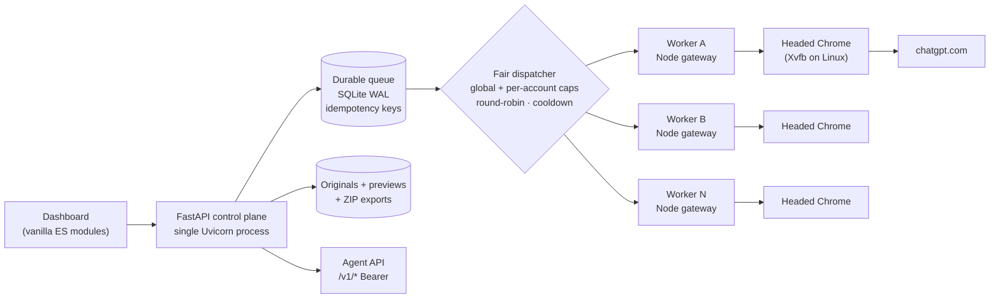

<div align="center">

# 🥷 Ninja Image Hub

**A self-hosted control plane for ChatGPT image generation — durable queue, fair dispatch, isolated browser workers, private originals.**

[](https://www.python.org/)
[](https://fastapi.tiangolo.com/)
[](https://nodejs.org/)
[](https://www.sqlite.org/wal.html)
[](#verification)
[](LICENSE)
[](#quick-start)

[Quick start](#quick-start) · [Architecture](#architecture) · [Capacity](#capacity-and-sizing) · [Operations](#operational-guardrails) · [Docs](#documentation) · [Limitations](#honest-limitations)

</div>

---

## What it does

Ninja Image Hub turns the ChatGPT **web UI** into a bounded, observable image-generation backend. Accounts are isolated browser workers; work is a **durable queue** with idempotency, global and per-account concurrency caps, round-robin fairness and provider cooldowns. Every generated image is stored as the **original bytes** and served privately (preview, download, per-job ZIP).



### Why this exists

Firing ten prompts in parallel from a script "works" until the first 429, the first timeout, or the first crash — then you have no idea which image came from which request, or whether an image was charged twice. This project makes the boring parts explicit:

- **One job, one identity.** `idempotency_key` means an ambiguous network retry returns the *same* job; reusing the key with a different payload is a `409`.
- **Bounded, fair concurrency.** `account_count × jobs_per_account × images_per_job` are independent dimensions — limits are enforced, not implied.
- **Uncertain is not failure.** If the upstream outcome is unknown, the job is `unknown` and **never** silently replayed; partial artifacts are preserved.
- **Memory is a budget.** Idle browsers stop themselves (`idle_worker_shutdown_minutes`), a free-RAM guard refuses new workers instead of OOM-killing the box, and a crash supervisor brings browsers back with backoff.

> **Images only.** There is no video pipeline here. The queue/worker layer is provider-agnostic, but the only adapter that ships speaks the OpenAI-compatible image API of the bundled gateway.

---

## Features

| Area | What you get |
|---|---|
| **Queueing** | Durable queue in SQL, bounded candidate windows, global cap up to 32 inflight, per-account caps, round-robin fairness, live pause/resume that never drops queued work |
| **Reliability** | Crash supervisor with 30/120/600/1800 s backoff (gives up after 8 attempts), pre-send failures **requeue** instead of failing, restart-safe `running → unknown`, no automatic replay of ambiguous submissions |
| **Delivery** | Original bytes preserved (never re-encoded), private WebP previews ≤ 640 px, HTTP Range downloads, disk-backed ZIP per job, keyset gallery pagination on `(job_id, position)` |
| **Security** | Admin session + CSRF on every mutation, Bearer agent API, loopback-only panel, worker env allowlist (`APP_SECRET`/`ADMIN_PASSWORD` never reach the browser), 64 KiB control-body cap, path-traversal and SSRF guards |
| **Operations** | `/api/health` readiness counters, `scripts/doctor.py` preflight (exit 0/1 with the fix command), live settings in the DB with an audit trail, per-account worker logs, gateway session status |
| **Scale** | 10 accounts / 10 concurrent generations on one process: 32-thread job pool, parallel health probes, RAM guard, on-demand workers, per-account port allocation |
| **Linux-first** | `deploy/install_linux.sh` + systemd unit, one **Xvfb per worker** (browser stays headed — headless is an anti-bot signal), SSH-tunnel access, headless-server login through the dashboard |

---

## Architecture

| Layer | Responsibility |
|---|---|
| `app.py` | 5-line ASGI entrypoint; only `create_app()` builds the instance |
| `hub/factory.py`, `hub/runtime.py` | Explicit composition, per-instance `ctx`, JS MIME pin, route table |
| `hub/jobs.py`, `hub/scheduler.py` | Durable queue, fairness, health snapshots, wake/reap, supervisor |
| `hub/accounts.py`, `hub/workers.py` | Account lifecycle, ports, env allowlist, Xvfb, orphan reclaim |
| `hub/media.py`, `hub/storage.py`, `hub/delivery.py` | Chunked budgets, atomic publish, previews, ZIP, Range |
| `hub/security.py`, `hub/limits.py` | Session/CSRF/Bearer, UTF-8-safe secret compare, body caps |
| `hub/control.py`, `hub/system.py`, `hub/telemetry.py` | Live settings + audit, health, analytics |
| `frontend/` | Native ES modules (state · api · controller · views · accounts) |
| `deploy/` | Linux installer and systemd unit |
| `scripts/` | `doctor.py`, `prepare_gateway.py`, `serve_preview.py`, bootstrap, audit, benchmark |

No `exec`, no dynamic imports, no global singleton database: `create_app()` composes an independent runtime and binds its routes.

---

## Capacity and sizing

A live worker is a real Chrome: **≈ 0.8–1.3 GB RAM**. Idle workers are stopped (default after 20 minutes) and woken by the next job, so the fleet only pays for browsers that are actually working.

| Target | RAM | CPU | Suggested settings |
|---|---|---|---|
| 1 account | 2 GB | 2 cores | `max_running_accounts=1`, `global_max_inflight=2`, `gateway_max_tabs=2`, `idle=20` |
| 3 accounts | 6 GB | 4 cores | `max_running_accounts=3`, `global_max_inflight=6`, `gateway_max_tabs=2`, `idle=15` |
| **10 accounts (validated target)** | **16 GB** | **8+ cores** | `max_running_accounts=10`, `global_max_inflight=10`, `gateway_max_tabs=1`, `parallel_limit=1`, `idle=10–15`, `min_free_memory_mb=800` |

Guards that keep 10 accounts from becoming an outage:

- `global_max_inflight` is capped at **32** and the executor is sized to match, so dispatch accounting and thread availability agree.
- `min_free_memory_mb` (default 600) refuses to start another browser when free RAM is below the threshold — you get a clear error instead of a kernel OOM that kills every worker and the dashboard.
- Health probes run through a 16-thread pool, so 10 accounts do not serialize the dispatcher.
- One Uvicorn process only. Scaling *accounts* is fine; scaling *web processes* against one SQLite file is not supported.
- Disk: ≈ 2–5 MB per original PNG; a 1 000-image library is ≈ 3–5 GB plus small WebP previews.

---

## Quick start

### Windows

```powershell
git clone https://github.com/BobbyJoonz/ninja-image-hub.git
cd ninja-image-hub
pip install -r requirements.txt
python scripts/bootstrap.py        # unique secrets, printed once — save the admin password
python scripts/doctor.py           # pre-flight: fix every FAIL it lists
python scripts/prepare_gateway.py  # third-party gateway + browser binaries (needs Node 22 + Git)
start_windows.bat                  # or: python -m uvicorn app:app --host 127.0.0.1 --port 8081 --workers 1
```

Open **http://127.0.0.1:8081**. Port 8080 is intentionally *not* the default (common local conflicts); `doctor.py` suggests a free one.

### Linux server

```bash
sudo bash deploy/install_linux.sh        # packages, Node 22, Chrome, Xvfb, venv, .env, systemd
sudo -u ninja -i && cd /opt/ninja-image-hub
.venv/bin/python scripts/doctor.py
.venv/bin/python scripts/prepare_gateway.py --yes
sudo systemctl restart ninja-image-hub
```

The panel stays on loopback — reach it through a tunnel:

```bash
ssh -N -L 8081:127.0.0.1:8081 user@server
# browse http://127.0.0.1:8081
```

### First account and first image

1. **Accounts → Add account → Start.** The worker boots its own browser (and its own Xvfb on Linux).
2. **Accounts → Login → Open ChatGPT**, sign in (password/2FA are typed straight into the worker browser — the Hub stores nothing).
3. **Save Session** — this persists the session to `data/accounts/<id>/gateway/auth/session.json`, which is what survives restarts and idle shutdowns.
4. **Image Studio → prompt → Generate.** Results land in **Gallery**; `Download original` returns the untouched bytes, `Job ZIP` bundles one job.

> On a headless server there is no monitor to watch: the login page streams the server-side browser and forwards clicks/typing. If it says *"login session is not active"*, press **Open ChatGPT** first.

---

## How the queue behaves

| Situation | Behaviour |
|---|---|
| Same `idempotency_key`, same payload | Returns the original job — no duplicate generation |
| Same key, different payload | `409 Conflict` |
| Upstream timeout / 5xx after submission | Job becomes `unknown`; **never** auto-retried; inspect manually |
| Rate limit (429) | Account gets a cooldown (≥ 30 min, longer `Retry-After` wins); no account switching, no quota bypass |
| Worker not yet reachable before send | Job returns to `queued` (nothing was submitted) |
| Operator stops an account | Its jobs stay queued; it is **never** auto-woken |
| Idle account | Browser stops after `idle_worker_shutdown_minutes`; the next job or the login page wakes it |
| Panel hard-killed | Next start reclaims only gateways that provably belong to that account, killing the whole Node + Chrome tree |

---

## Operational guardrails

- **One Uvicorn process.** `--workers 1`. The queue, dispatch locks and supervisor live in-process; a second process corrupts them.
- **Back up `.env` and the entire `data/` directory** (SQLite runs in WAL mode — copy `hub.db`, `hub.db-wal`, `hub.db-shm` together while stopped, or use `sqlite3 .backup`).
- **Dedicated ChatGPT account.** UI automation may violate OpenAI's Terms of Use and can get an account suspended. Never use your main account, never bypass MFA/CAPTCHA/rate limits.
- **Watch disk and RAM.** `GET /api/health` reports workers, queue depth and worker policy; `doctor.py` reports headroom.
- **Keep the browser headed.** Headless is an anti-bot signal. On Linux the Hub runs each worker under its own Xvfb; do not set `HEADLESS=true`.

---

## Verification

```bash
python -m pytest -q                      # 74 passed, 1 skipped  (~96 s)
node --test tests/frontend.test.mjs      # 3 passed
node --check frontend/app.js             # + all 6 modules, preview/demo.js
python scripts/doctor.py                 # 0 failures = ready
```

What the suite covers: account lifecycle, CSRF/Bearer auth, legacy SQL migration, fairness and caps, a 500-job queue, multi-image responses, partial and unknown outcomes, cooldown without rotation, byte-identical originals, Range requests, paginated gallery, ZIP export, redirect/symlink/SSRF rejection, size budgets and rollback cleanup, plus the hardening regressions (MIME, worker env, WAL, requeue, supervisor, RAM guard, Xvfb command, deploy assets, on-demand wake/reap).

Live smoke test on a real account: `n=2` job → `completed`, two distinct original PNGs, gallery and ZIP verified; killing the worker mid-flight was recovered automatically and the next job still completed; an idle worker was reaped in 37 s and woken by the next job.

Tests use **mock gateways and synthetic images** — they are not a claim of verified ChatGPT Plus behaviour.

---

## Documentation

| Document | Contents |
|---|---|
| [START_HERE_V6_FA.md](START_HERE_V6_FA.md) | Persian quickstart and troubleshooting table |
| [REPORT_V6_FA.md](REPORT_V6_FA.md) | Release report: what was broken, what was fixed, evidence |
| [docs/FIRST_RUN_FA.md](docs/FIRST_RUN_FA.md) | Deep first-run: doctor, gateway, login, first image, backup |
| [docs/OPERATIONS_V6_FA.md](docs/OPERATIONS_V6_FA.md) | Capacity, failure modes, monitoring, on-demand workers |
| [docs/DEPLOY_LINUX_FA.md](docs/DEPLOY_LINUX_FA.md) | Linux server deployment, Xvfb, systemd, headless login |
| [docs/ARCHITECTURE_V5_FA.md](docs/ARCHITECTURE_V5_FA.md) | Module layout and data flow |
| [AGENTS.md](AGENTS.md) | Development contract and non-negotiable invariants |

---

## Honest limitations

- The browser gateway is a **third-party, unofficial** adapter (`stufently/gpt-web-gateway`, MIT). It is not bundled; `scripts/prepare_gateway.py` installs it from a pinned commit.
- **No SLA.** ChatGPT UI changes, Cloudflare challenges, session expiry, 2FA and account-level limits are outside this software's control.
- **PostgreSQL and multiple replicas are not supported.** Single process, single SQLite file (WAL).
- `Best` / `Balanced` / `Draft` are **prompt guidance only**, not upstream API quality parameters.
- Account plan labels are manual and unverified.
- No video generation.

---

## License

[MIT](LICENSE) © 2026 Amirali (BobbyJoonz)

Not affiliated with, endorsed by, or sponsored by OpenAI. "ChatGPT" is a trademark of its owner; this project only automates a browser session you own.
