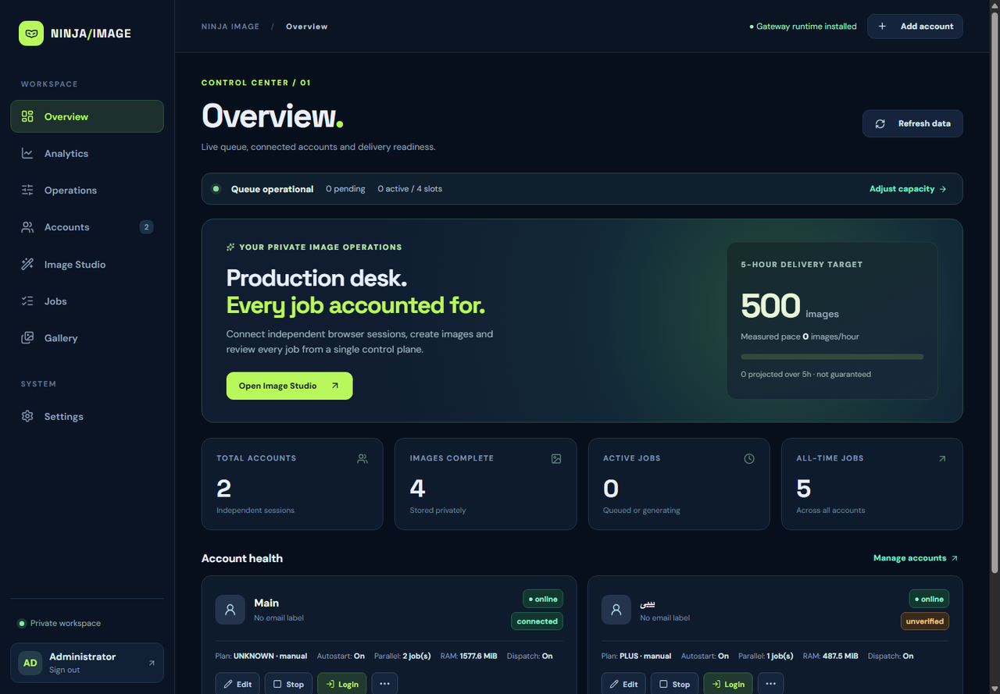
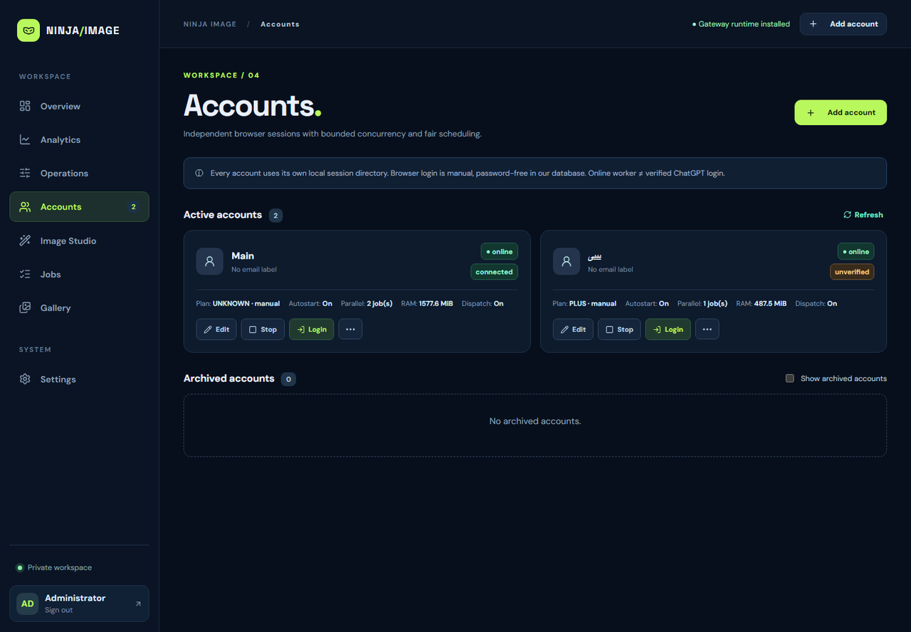
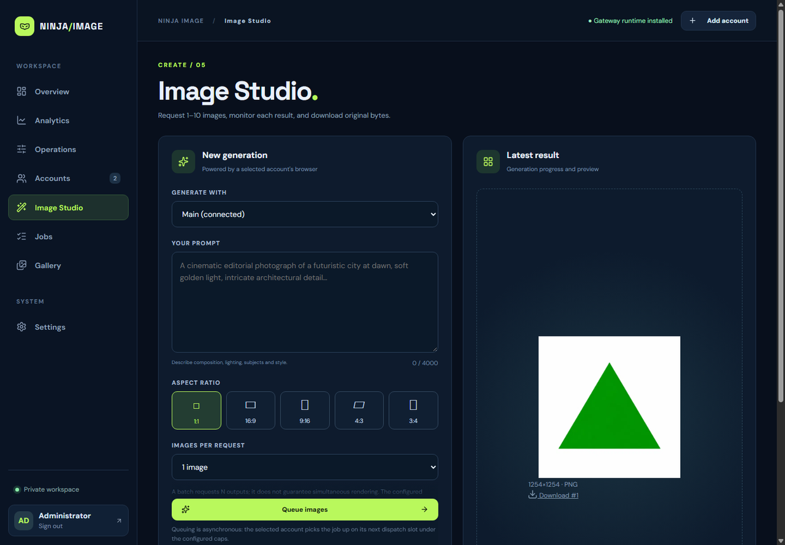
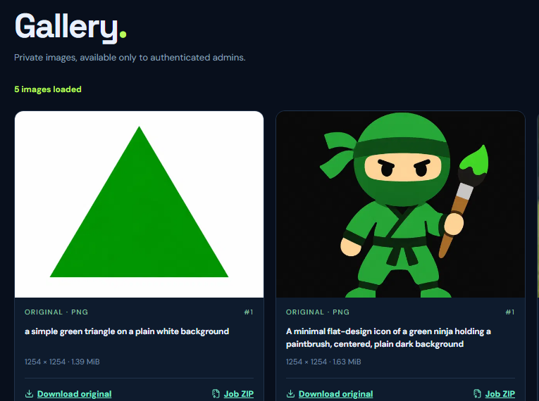
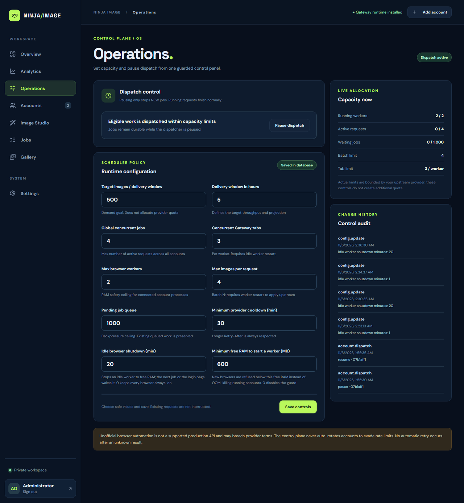
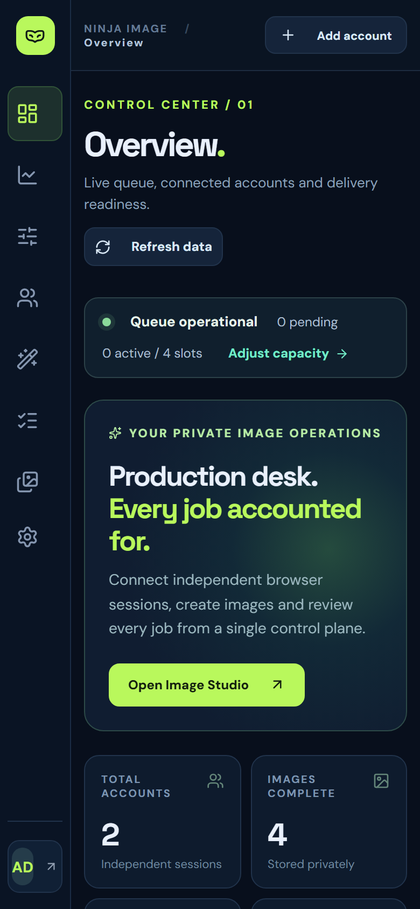
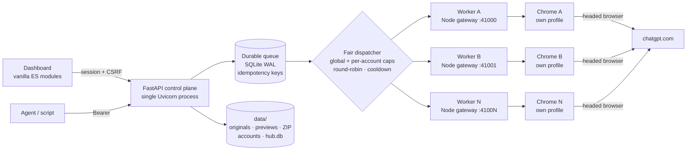
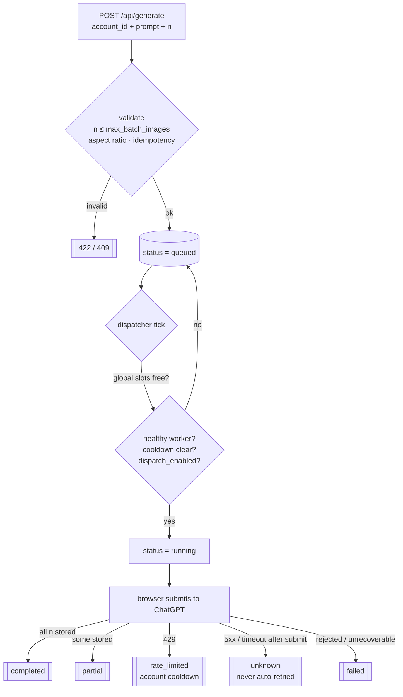

<div align="center">


# Ninja Image Hub

**A self-hosted control plane that turns ChatGPT's web UI into a multi-account image factory — durable queue, fair dispatch, isolated browser workers, private originals.**

[](https://www.python.org/)
[](https://fastapi.tiangolo.com/)
[](https://nodejs.org/)
[](https://www.sqlite.org/wal.html)
[](#verification)
[](#multi-account-model)
[](LICENSE)
[](#quick-start)

[Quick start](#quick-start) · [Multi-account](#multi-account-model) · [Every option](#complete-option-reference) · [Capacity](#capacity-and-sizing) · [API](#http-api-reference) · [Docs](#documentation)

</div>

---

## Table of contents

1. [What it is](#what-it-is)
2. [Screens](#screens)
3. [Architecture](#architecture)
4. [Multi-account model](#multi-account-model) ← the core of this project
5. [Capacity and sizing](#capacity-and-sizing)
6. [Queue semantics](#queue-semantics)
7. [On-demand workers](#on-demand-workers)
8. [Quick start](#quick-start)
9. [Complete option reference](#complete-option-reference)
10. [HTTP API reference](#http-api-reference)
11. [Scripts, files and storage](#scripts-files-and-storage)
12. [Operations](#operations)
13. [Verification](#verification)
14. [Documentation](#documentation)
15. [Honest limitations](#honest-limitations)
16. [License](#license)

---

## What it is

One FastAPI process owns a **durable job queue**; each ChatGPT account is a **separate, isolated browser worker** (Node gateway + real headed Chrome, plus its own virtual display on Linux). The dispatcher hands work to accounts under global and per-account caps, with round-robin fairness and per-account cooldowns. Generated images are stored as **original bytes** and served privately: previews, Range downloads, per-job ZIP, and a Bearer agent API for automation.

> **Images only.** There is no video pipeline. The queue/worker layer is provider-agnostic, but the only adapter that ships speaks the OpenAI-compatible image API of the bundled gateway.

**Offline-first interface.** Every icon is a bundled **Lucide** SVG (ISC) served from `/static/icons/sprite.svg` — no CDN, no Unicode fallbacks, one optical size and inherited colour. Jobs are searchable and filterable (status chips), the mobile layout turns tables into cards, account actions collapse into a keyboard-friendly overflow menu, first paint uses skeletons instead of empty boxes, and notifications stack with icons and dismiss buttons. Accessibility: skip link, `aria-current` navigation, labelled icon-only buttons, AA contrast and `prefers-reduced-motion` support. Regenerate icons with `python scripts/build_icons.py`.

### Why this exists

A script that fires ten prompts in parallel "works" until the first `429`, the first timeout, or the first crash — then nobody knows which image belongs to which request, or whether one was charged twice. This project makes the hard parts explicit: idempotent jobs, bounded fairness across accounts, unknown-outcome handling that never silently re-generates, and per-account failure isolation.

---

## Screens

<table>
<tr>
<td width="50%">
<a href="docs/images/overview.png"></a>
<br/><sub><b>Overview</b> — queue state, per-account health, plan and RAM, delivery target</sub>
</td>
<td width="50%">
<a href="docs/images/accounts.png"></a>
<br/><sub><b>Accounts</b> — every browser session is an independent account</sub>
</td>
</tr>
<tr>
<td width="50%">
<a href="docs/images/studio.png"></a>
<br/><sub><b>Image Studio</b> — prompt, aspect ratio, batch size, quality guidance</sub>
</td>
<td width="50%">
<a href="docs/images/gallery.png"></a>
<br/><sub><b>Gallery</b> — originals preserved, private previews, per-job ZIP</sub>
</td>
</tr>
<tr>
<td colspan="2">
<a href="docs/images/operations.png"></a>
<br/><sub><b>Operations</b> — every runtime limit is a live, validated setting with an audit trail</sub>
</td>
</tr>
</table>

<p align="center"><br/>
<sub>The same dashboard at a 390 px viewport.</sub></p>

---

## Architecture



| Layer | Responsibility |
|---|---|
| `app.py` | 5-line ASGI entrypoint; only `create_app()` builds the instance |
| `hub/factory.py`, `hub/runtime.py` | Explicit composition, per-instance `ctx`, JS MIME pin, route table, thread pools |
| `hub/jobs.py` | Queue insert, idempotency, validation, serialization |
| `hub/scheduler.py` | Fair dispatch, health snapshot, wake/reap, crash supervisor |
| `hub/accounts.py`, `hub/workers.py` | Account lifecycle, port allocation, env allowlist, Xvfb, orphan reclaim |
| `hub/gateway.py` | Upstream HTTP contract (bounded JSON envelope, no replay) |
| `hub/media.py`, `hub/storage.py`, `hub/delivery.py` | Chunked budgets, atomic publish, previews, ZIP, Range |
| `hub/security.py`, `hub/limits.py` | Session/CSRF/Bearer, UTF-8-safe comparisons, body caps |
| `hub/control.py`, `hub/system.py`, `hub/telemetry.py` | Live settings + audit, health, analytics |
| `frontend/` | Native ES modules: state · api · controller · views · accounts · dom · `icons/sprite.svg` |
| `deploy/` | Linux installer + systemd unit |
| `scripts/` | doctor, gateway installer, preview server, bootstrap, audit, benchmark |

---

## Multi-account model

This is the heart of the project: **accounts are isolated execution slots, not rows in a table.**

### What one account actually is

| Piece | Detail |
|---|---|
| **Worker process** | `node src/server.js`, one per running account, started by the Hub |
| **Port** | allocated from `41000–41999`, unique per account, bound to `127.0.0.1` only |
| **Browser** | a real **headed** Chrome with its own persistent profile directory |
| **Display (Linux)** | each worker gets its **own Xvfb** (`xvfb-run -a -s "-screen 0 1440x900x24"`); never shared |
| **Secret** | per-account `api_secret` used as `Authorization: Bearer` between Hub and gateway |
| **Session** | saved to `data/accounts/<id>/gateway/auth/session.json` by **Save Session**; survives restarts and idle shutdown |
| **Logs** | `data/accounts/<id>/worker.log` (token/password redaction on read) |
| **Workspace** | `data/accounts/<id>/gateway/` — a private copy of the gateway sources per account |

### Isolation guarantees

- **Environment isolation.** The worker inherits only an allowlist of OS variables (`PATH`, `HOME`, `TEMP`, locale, display). `APP_SECRET`, `ADMIN_PASSWORD`, `AGENT_API_KEY` and `DATABASE_URL` are **never** passed to the gateway or its browser children.
- **Cookie isolation.** Each account's Chrome profile is separate; cookies are never logged, exported through the UI, or shared between workers.
- **Failure isolation.** One worker crashing shows up as that account being `stopped`; other accounts keep producing. The supervisor restarts each account independently.
- **Rate-limit isolation.** A `429` puts **only that account** in cooldown. The Hub never rotates accounts to dodge limits.
- **Resource isolation.** Each worker has its own port, process, display and profile. A hung Chrome cannot block another account's dispatch (health probes are parallel and time-bounded).

### How a job is routed



**There is no automatic account switching and no automatic replay.** The job is bound to the account you named; fairness decides *when*, not *where*.

### Fairness rules

| Rule | Behaviour |
|---|---|
| Global concurrency | `global_max_inflight` slots shared by all accounts |
| Per-account concurrency | `min(account.parallel_limit, gateway_max_tabs)` requests per account |
| Round-robin | candidate iteration continues from the last served account, so a busy account cannot starve a quiet one |
| Candidate window | per-account `row_number() ≤ global_max_inflight` — bounded SQL, no full-table scans |
| Cooldown | an account with `cooldown_until > now` is skipped, and its jobs stay queued |
| Paused dispatch | `dispatch_paused` stops **new** dispatch only; running jobs finish, queued jobs are kept |
| Cap changes | lowering `max_pending_jobs` never deletes or starves existing queued work |

### The 10-account recipe (validated target)

A live worker costs **≈ 0.8–1.3 GB RAM** (Node + Chrome). Idle workers stop after `idle_worker_shutdown_minutes`, so the fleet only pays for browsers that are actually working.

| Setting | Value for 10 accounts | Why |
|---|---|---|
| `max_running_accounts` | `10` | hard ceiling on live browsers |
| `global_max_inflight` | `10` (max `32`) | executor is 32 threads, so accounting and capacity agree |
| `gateway_max_tabs` | `1` | each tab is a full ChatGPT page; 1 per account keeps RAM predictable |
| `parallel_limit` (per account) | `1–2` | total across accounts must stay under the global cap |
| `idle_worker_shutdown_minutes` | `10–15` | frees RAM between bursts |
| `min_free_memory_mb` | `800` | refuses a new browser instead of letting the kernel OOM the box |
| `provider_cooldown_minutes` | `30` | account-level penalty after a rate limit |
| Server | **16 GB RAM, 8+ cores** | 10 × 1.0–1.3 GB + panel |

**Expected throughput.** The gateway paces upstream turns itself (`MIN_JOB_GAP_SEC=60`, `MIN_TURN_STAGGER_SEC=10`), so a single account tops out at roughly one job per minute. Ten healthy accounts therefore reach the order of **~10 jobs/min**; with `n=4` images per job that is ~40 images/min *if the provider cooperates*. Software limits never imply provider quota — the Hub cannot create capacity that ChatGPT does not offer.

### What happens at the edges

| Event | Effect on a 10-account fleet |
|---|---|
| One account gets `429` | that account cools down; the other nine keep working; its jobs stay queued |
| One Chrome dies | supervisor restarts it (30/120/600/1800 s backoff, gives up after 8 attempts, manual Start re-arms) |
| Panel hard-killed | next start reclaims only gateways that provably belong to that account, killing the whole Node + Chrome tree |
| Free RAM below guard | new worker start is refused with a clear error; running accounts keep working |
| Queue fills to `max_pending_jobs` | `POST /api/generate` returns `429` with "retry later without changing the idempotency key" |
| Job waits while its account is stopped | it stays `queued` forever — by design, operator stop is respected |

---

## Capacity and sizing

| Target | RAM | CPU | Suggested configuration |
|---|---|---|---|
| 1 account | 2 GB | 2 cores | `max_running_accounts=1`, `global_max_inflight=2`, `gateway_max_tabs=2`, `idle=20` |
| 3 accounts | 6 GB | 4 cores | `max_running_accounts=3`, `global_max_inflight=6`, `gateway_max_tabs=2`, `idle=15` |
| **10 accounts** | **16 GB** | **8+ cores** | `max_running_accounts=10`, `global_max_inflight=10`, `gateway_max_tabs=1`, `parallel_limit=1`, `idle=10–15`, `min_free_memory_mb=800` |
| 16 accounts (max) | 24 GB+ | 16 cores | same shape, `max_running_accounts=16`, `global_max_inflight=16` |

Disk: ≈ 2–5 MB per original PNG; a 1 000-image library is ≈ 3–5 GB plus small WebP previews and temporary export ZIPs. Previews are capped at 640 × 640; preview generation refuses images above 24 megapixels.

---

## Queue semantics

| Situation | Behaviour |
|---|---|
| Same `idempotency_key`, same payload | returns the original job (`deduplicated: true`), no second generation |
| Same key, different payload | `409 Conflict` |
| Upstream timeout / 5xx **after** submission | job becomes `unknown`; never retried; inspect manually |
| Worker unreachable **before** send | job returns to `queued` (nothing was submitted) |
| Rate limit `429` | account cooldown (≥ `provider_cooldown_minutes`, longer `Retry-After` wins) |
| Gateway returns fewer images | `partial`, with the missing count and any save error recorded |
| Gateway returns an unusable image | `failed` with a bounded error string; other outputs of the job are kept |
| Operator deletes a queued job | `canceled`, job retained for auditing |
| Operator deletes a settled job | row and files removed; `running` deletion is refused |

**Job statuses:** `queued` → `running` → `completed` · `partial` · `failed` · `unknown` · `rate_limited` · `canceled`.

---

## On-demand workers

Browsers are expensive; idle ones are stopped by default.

- `idle_worker_shutdown_minutes` (default **20**, `0` = always-on) stops a worker that has no active job, no queued job, and no recent login-page use.
- The **next queued job** or **opening the login page** wakes it automatically. Wake attempts back off 20 s → 40 s → … → 300 s, so a broken install cannot spawn processes every tick.
- The session comes back from `auth/session.json`; idle shutdown does not burn the login.
- An account stopped by the operator is **never** auto-woken.
- `GET /api/health` reports `running_workers`, `idle_workers` and `worker_policy` so monitoring can tell "idle by design" from "broken".

Measured on the validation host: idle reap after 37 s (`running_workers: 0, idle_workers: 1`), then a new job woke the worker and completed normally.

---

## Quick start

### Windows

```powershell
git clone https://github.com/BobbyJoonz/ninja-image-hub.git
cd ninja-image-hub
pip install -r requirements.txt
python scripts/bootstrap.py        # unique secrets, printed once — save the admin password
python scripts/doctor.py           # pre-flight; fix every FAIL it lists
python scripts/prepare_gateway.py  # third-party gateway + browser binaries (Node 22 + Git required)
start_windows.bat                  # or: python -m uvicorn app:app --host 127.0.0.1 --port 8081 --workers 1
```

Open **http://127.0.0.1:8081**.

### Linux server

```bash
sudo bash deploy/install_linux.sh        # packages, Node 22, Chrome, Xvfb, venv, .env, systemd
sudo -u ninja -i && cd /opt/ninja-image-hub
.venv/bin/python scripts/doctor.py
.venv/bin/python scripts/prepare_gateway.py --yes
sudo systemctl restart ninja-image-hub
```

The panel stays on loopback; reach it through a tunnel:

```bash
ssh -N -L 8081:127.0.0.1:8081 user@server
# browse http://127.0.0.1:8081
```

### First account and first image

1. **Accounts → Add account → Start** — the worker boots its own browser (and its own Xvfb on Linux).
2. **Accounts → Login → Open ChatGPT** — sign in; credentials are typed straight into the worker browser and never stored by the Hub.
3. **Save Session** — persists the session to `data/accounts/<id>/gateway/auth/session.json`.
4. **Image Studio → prompt → Generate** — results land in **Gallery**; `Download original` returns untouched bytes, `Job ZIP` bundles one job.

> On a headless server there is no monitor: the login page streams the server-side browser and forwards clicks/typing. If it says *"login session is not active"*, press **Open ChatGPT** first.

---

## Complete option reference

### A. Runtime settings (Operations panel, stored in the database)

All of these are **live** unless marked *restart*. Every change requires admin session + CSRF and is appended to the control audit (without secrets).

| Setting | Default | Range | Applies | What it does |
|---|---|---|---|---|
| `target_images` | `500` | 1–100000 | immediately | Demand goal used only for the delivery projection; it does **not** allocate provider quota |
| `target_window_hours` | `5` | 1–24 | immediately | Window for the projection and throughput display |
| `global_max_inflight` | `4` | 1–**32** | next tick | Maximum active requests across all accounts |
| `gateway_max_tabs` | `3` | 1–5 | **restart** | Tabs one worker may run concurrently; also caps per-account parallelism |
| `max_running_accounts` | `2` | 1–16 | next tick | Hard ceiling on live browser workers (RAM safety) |
| `max_batch_images` | `4` | 1–10 | **restart** | Maximum `n` per request (also drives the Studio selector) |
| `max_pending_jobs` | `1000` | 1–10000 | immediately | Backpressure ceiling; existing queued work is preserved |
| `provider_cooldown_minutes` | `30` | 1–240 | next tick | Minimum cooldown after a rate limit; a longer `Retry-After` always wins |
| `idle_worker_shutdown_minutes` | `20` | 0–1440 | next tick | Stop an idle browser; `0` = always-on |
| `min_free_memory_mb` | `600` | 0–65536 | next start | Refuse to start a browser when free RAM is below this; `0` disables the guard |
| `dispatch_paused` | `0` | 0/1 | next tick | Pause **new** dispatch only; running jobs finish, queued jobs are kept |

*restart* = the worker must be restarted (Stop → Start) for the value to reach the gateway. The API returns `restart_required` in the response and the UI shows it.

### B. Environment variables (`.env`)

| Variable | Required | Meaning |
|---|---|---|
| `APP_SECRET` | **yes**, ≥ 32 chars | Session-cookie signing key (`bootstrap.py` generates it) |
| `ADMIN_PASSWORD` | **yes**, ≥ 12 chars | Panel password; non-ASCII (e.g. Persian) is supported |
| `AGENT_API_KEY` | optional | Enables the Bearer `/v1/*` agent API |
| `COOKIE_SECURE` | optional | `true` when the panel is behind HTTPS |
| `DATA_DIR` | optional | Data root (default `./data`) |
| `DATABASE_URL` | optional | SQLite by default; PostgreSQL is *not* validated |
| `GLOBAL_MAX_INFLIGHT`, `GATEWAY_MAX_TABS`, `MAX_PENDING_JOBS`, `MAX_BATCH_IMAGES`, `PROVIDER_COOLDOWN_MINUTES`, `MAX_RUNNING_ACCOUNTS`, `IDLE_WORKER_SHUTDOWN_MINUTES`, `MIN_FREE_MEMORY_MB` | optional | Seed values for a **fresh** database only; afterwards the DB/panel wins |

### C. CLI scripts

| Command | Flags | Purpose |
|---|---|---|
| `python scripts/bootstrap.py` | — | Create `.env` with unique secrets once; refuses to overwrite an existing one |
| `python scripts/doctor.py` | `--json` | Pre-flight checklist: Python/Node/Chrome, packages, secrets, JS MIME, data dir, WAL, gateway + browser binaries, RAM budget, ports, Linux display/libraries/fonts. Exit `0` = ready, `1` = at least one FAIL with the fixing command |
| `python scripts/prepare_gateway.py` | `--yes`, `--skip-browsers` | Complete gateway install: lockfile refusal, pinned revision, `npm ci`, `npx playwright install chromium`, `npx patchright install chrome`. Falls back to a `codeload.github.com` tarball when GitHub is blocked, and tolerates a geo-blocked browser CDN when system Chrome exists |
| `python scripts/build_icons.py` | `--check` | Regenerates the bundled Lucide icon sprite (`frontend/icons/sprite.svg`, ISC) from a pinned version; `--check` verifies every icon the UI references |
| `python scripts/serve_preview.py` | `--host`, `--port` | Serves `preview/dist` with correct MIME types (the sample-data preview) |
| `python scripts/audit_gallery.py` | — | **Read-only** report of missing/unindexed files; never deletes anything |
| `python scripts/benchmark_transfer.py` | — | Synthetic memory benchmark of the storage stage |
| `sudo bash deploy/install_linux.sh` | `--upgrade` | Install/upgrade on Linux: packages, Node 22, Chrome, Xvfb, venv, `.env`, systemd |
| `start_windows.bat` / `start_linux.sh` | — | Create `.env` if missing, then serve `127.0.0.1:8081 --workers 1` |

### D. Delivery budgets (hard limits, not configuration)

| Limit | Value |
|---|---|
| Control JSON body | 64 KiB |
| Upstream generation JSON envelope | 32 MiB (spooled to disk; exceeded → `unknown`) |
| Single image | 64 MiB, ≤ 90 megapixels |
| Preview decode cap | 24 megapixels (preview refused, original still downloadable) |
| ZIP export per job | ≤ 10 files, ≤ 640 MiB, ZIP_STORED, disk-backed |
| Concurrent preview renders | 2 |
| Concurrent ZIP exports | 2 |

---

## HTTP API reference

**Auth:** admin routes need the session cookie (`POST /api/auth/login`) plus `x-csrf-token` on mutations. Agent routes need `Authorization: Bearer $AGENT_API_KEY`.

| Method & path | Auth | Purpose |
|---|---|---|
| `POST /api/auth/login` | — | `{password}` → `{ok, csrf}`; 6 attempts / 10 min per IP |
| `GET /api/auth/me` | — | `{authenticated, csrf}` |
| `POST /api/auth/logout` | CSRF | Clear the session |
| `GET /api/health` | — | Public readiness counters (no paths/secrets) |
| `GET /api/overview` | admin | Counts for the dashboard |
| `GET /api/accounts` | admin | Accounts + runtime/session/memory status |
| `POST /api/accounts` | CSRF | `{name, plan_label?, parallel_limit?, autostart?, email_label?}` |
| `PATCH /api/accounts/{id}` | CSRF | Rename / plan / parallel limit / autostart |
| `POST /api/accounts/{id}/start` \| `/stop` | CSRF | Start or stop the worker |
| `POST /api/accounts/{id}/dispatch/{pause\|resume}` | CSRF | Toggle new dispatch for one account |
| `POST /api/accounts/{id}/archive` \| `/restore` \| `/purge` | CSRF | Archive, restore, or permanently delete (purge needs `DELETE <name>` confirmation) |
| `GET /api/accounts/{id}/logs` | admin | Tail of the worker log (redacted) |
| `GET /accounts/{id}/login` | admin | Remote-login page (streams the server browser) |
| `GET /api/accounts/{id}/remote/{init\|screenshot}` | admin | Start/refresh the login session, grab a frame |
| `POST /api/accounts/{id}/remote/{click\|type\|key\|navigate\|save}` | CSRF | Drive the browser and persist the session |
| `POST /api/generate` | CSRF | `{account_id, prompt, aspect_ratio, quality_preference, n, idempotency_key?}` → `202` |
| `GET /api/jobs?limit=` | admin | Recent jobs (≤ 200) with image metadata |
| `GET /api/jobs/{id}` | admin | One job with all outputs |
| `DELETE /api/jobs/{id}` | CSRF | Cancel queued / delete settled job |
| `GET /api/gallery?limit=&cursor=` | admin | Keyset page of individual outputs (≤ 100) |
| `GET /api/images/{job}/{pos}` | admin | Original bytes; `?download=true` for attachment; supports Range |
| `GET /api/images/{job}` | admin | First output (legacy-compatible route) |
| `GET /api/previews/{job}/{pos}` | admin | Derived WebP preview (≤ 640 px) |
| `GET /api/exports/jobs/{id}.zip` | admin | Disk-backed ZIP of one job's originals |
| `GET /api/queue` | admin | Live queue counters and capacity |
| `GET /api/analytics?hours=5\|24\|168\|720` | admin | Window analytics (images counted at `stored_at`) |
| `GET /api/control` | admin | All runtime settings + restart hints |
| `PATCH /api/control` | CSRF | Change settings (validated, audited) |
| `GET /api/control/audit?limit=` | admin | Change history without secrets |
| `GET /api/settings` | admin | Environment snapshot (gateway, DB, paths) |
| `POST /v1/images/generations` | Bearer | Agent create — same body as `/api/generate`, returns `202` |
| `GET /v1/jobs/{id}` | Bearer | Agent job status |
| `GET /v1/images/{job}[/{pos}]` | Bearer | Agent download |
| `GET /v1/exports/jobs/{id}.zip` | Bearer | Agent ZIP export |

Example — queue a two-image job:

```bash
curl -s -X POST http://127.0.0.1:8081/api/generate \
  -H "Content-Type: application/json" -H "x-csrf-token: $CSRF" \
  -d '{"account_id":"<id>","prompt":"flat green ninja icon","aspect_ratio":"1:1",
       "quality_preference":"balanced","n":2,"idempotency_key":"batch-2026-11-06-001"}'
```

Example — agent API:

```bash
curl -s -X POST http://127.0.0.1:8081/v1/images/generations \
  -H "Authorization: Bearer $AGENT_API_KEY" -H "Content-Type: application/json" \
  -d '{"account_id":"<id>","prompt":"a minimal blue circle","n":1,"idempotency_key":"agent-0001"}'
```

---

## Scripts, files and storage

```
data/
  hub.db (+ -wal/-shm)      SQLite database (WAL)
  gallery/<job>-<pos>.png   original bytes, atomic no-clobber publish
  previews/*.webp           derived previews (safe to delete)
  exports/                  temporary ZIPs (deleted after download)
  accounts/<id>/gateway/    per-account gateway copy + auth/session.json
  accounts/<id>/worker.log  per-account gateway log
  server.log / server.err   panel log when started by the launcher
```

Backup: stop the panel, then copy `.env` **and the whole `data/` directory** (WAL means `hub.db` alone is incomplete), or use `sqlite3 .backup`.

---

## Operations

```bash
# status / logs
curl -s http://127.0.0.1:8081/api/health | jq
journalctl -u ninja-image-hub -f                    # systemd
tail -f data/accounts/*/worker.log                  # per-browser logs

# safe restart (single process!)
sudo systemctl restart ninja-image-hub              # Linux
python -m uvicorn app:app --host 127.0.0.1 --port 8081 --workers 1   # manual
```

Guardrails:

- **One Uvicorn process.** `--workers 1`. The queue, dispatch locks and supervisor live in-process; a second process corrupts them.
- **Loopback only.** Use an SSH tunnel; if you must expose it, add HTTPS, authentication and a firewall, and set `COOKIE_SECURE=true`.
- **Dedicated ChatGPT account.** UI automation may violate OpenAI's Terms of Use and risk suspension. Never use a main account; never bypass MFA/CAPTCHA/rate limits.
- **Keep the browser headed.** Headless is an anti-bot signal; on Linux each worker runs under its own Xvfb.

---

## Verification

```bash
python -m pytest -q                     # 84 passed, 1 skipped  (~96 s)
node --test tests/frontend.test.mjs     # 5 passed
node --check frontend/app.js            # + all modules + preview/demo.js
python scripts/doctor.py                # exit 0 = ready
```

Covered by the suite: account lifecycle, CSRF/Bearer auth, legacy SQL migration, fairness and caps, a 500-job queue, multi-image responses, partial/unknown outcomes, cooldown without rotation, byte-identical originals, Range requests, paginated gallery, ZIP export, redirect/symlink/SSRF rejection, size budgets and rollback cleanup, plus hardening regressions (JS MIME, worker env, SQLite WAL, requeue, supervisor, RAM guard, Xvfb command, deploy assets, on-demand wake/reap).

Live smoke tests on a real account: `n=2` job → `completed` with two distinct originals, gallery and ZIP verified; worker killed mid-flight → automatic recovery; idle worker reaped in 37 s → next job woke it and completed.

Tests use **mock gateways and synthetic images** — they are not a claim of verified ChatGPT Plus behaviour.

---

### Signing in to ChatGPT

Open **Accounts → ↗ Login** and pick one of three methods: the **remote login page** (works on a headless Linux server), the **visible Chrome window** (easiest on a desktop), or **automatic login** with stored per-account credentials (best for long runs and 10-account fleets). Step-by-step guide with screenshots and troubleshooting: [docs/LOGIN_FA.md](docs/LOGIN_FA.md).

Credentials from the iframe form are stored only in `data/accounts/<id>/auto-login.json` (mode 0600), are never returned by the API, and are audited without secrets.

## Documentation

| Document | Contents |
|---|---|
| [START_HERE_FA.md](START_HERE_FA.md) | Persian quickstart + troubleshooting table |
| [REPORT_FA.md](REPORT_FA.md) | Release report: what was broken, what changed, evidence |
| [docs/FIRST_RUN_FA.md](docs/FIRST_RUN_FA.md) | Deep first-run: doctor, gateway, login, first image, backup |
| [docs/OPERATIONS_FA.md](docs/OPERATIONS_FA.md) | Capacity, failure modes, monitoring, on-demand workers |
| [docs/DEPLOY_LINUX_FA.md](docs/DEPLOY_LINUX_FA.md) | Linux deployment, Xvfb, systemd, headless login, reuse in other automations |
| [docs/ARCHITECTURE_FA.md](docs/ARCHITECTURE_FA.md) | Module layout and data flow |
| [AGENTS.md](AGENTS.md) | Development contract and non-negotiable invariants |

---

## Honest limitations

- The browser gateway is a **third-party, unofficial** adapter (`stufently/gpt-web-gateway`, MIT). It is not bundled; `prepare_gateway.py` installs a pinned revision.
- **No SLA.** ChatGPT UI changes, Cloudflare challenges, session expiry, 2FA and account-level limits are outside this software's control. Ten accounts do not create provider quota.
- **PostgreSQL and multiple replicas are not supported.** Single process, single SQLite file (WAL).
- `Best` / `Balanced` / `Draft` are **prompt guidance only**, not upstream API quality parameters.
- Account plan labels are manual and unverified.
- **No video generation.**

---

## License

[MIT](LICENSE) © 2026 Amirali (BobbyJoonz)

Not affiliated with, endorsed by, or sponsored by OpenAI. "ChatGPT" is a trademark of its owner; this project only automates a browser session you own.
