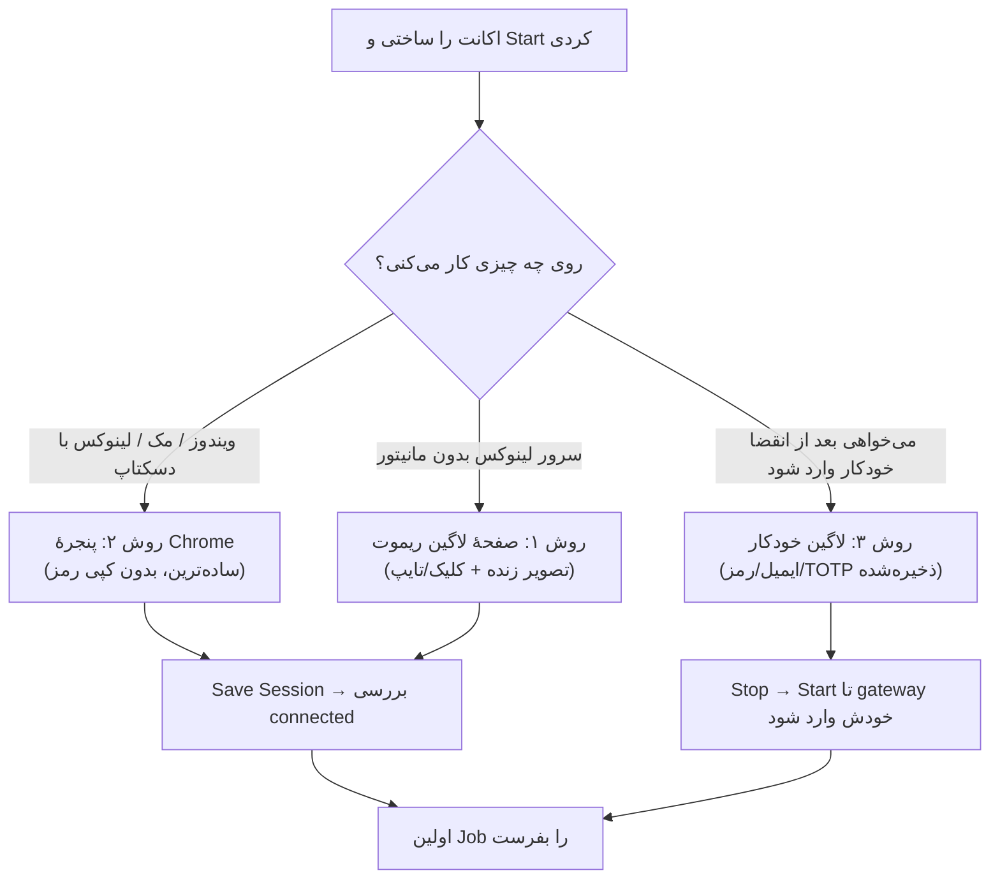
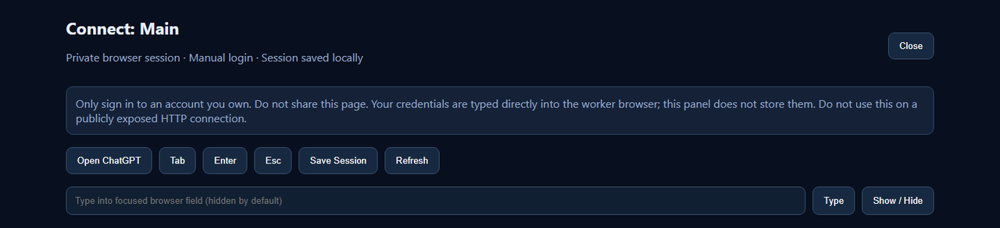
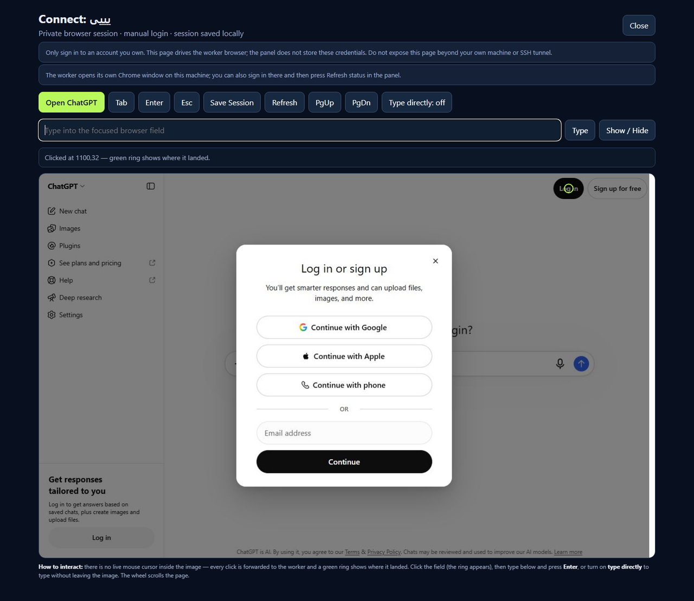
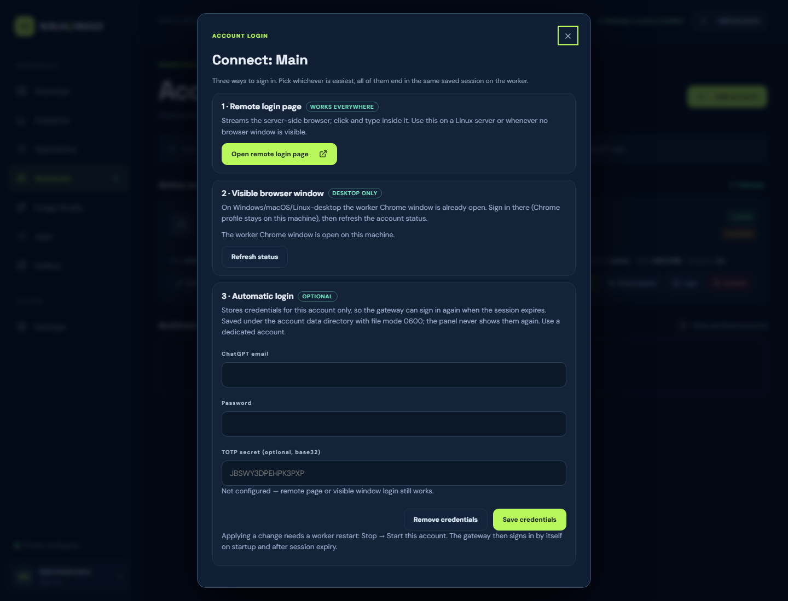
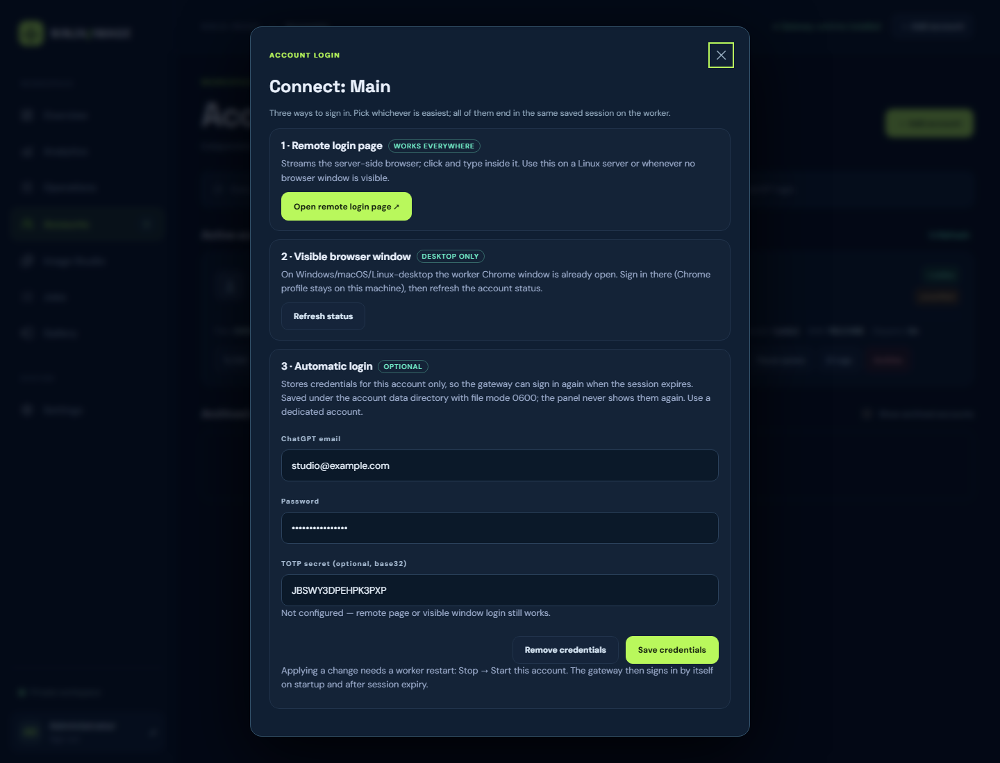
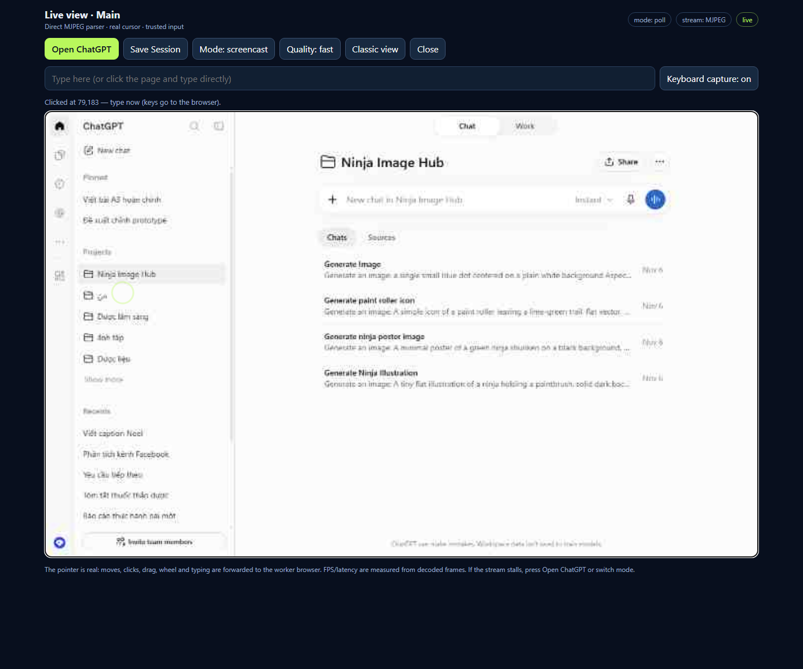
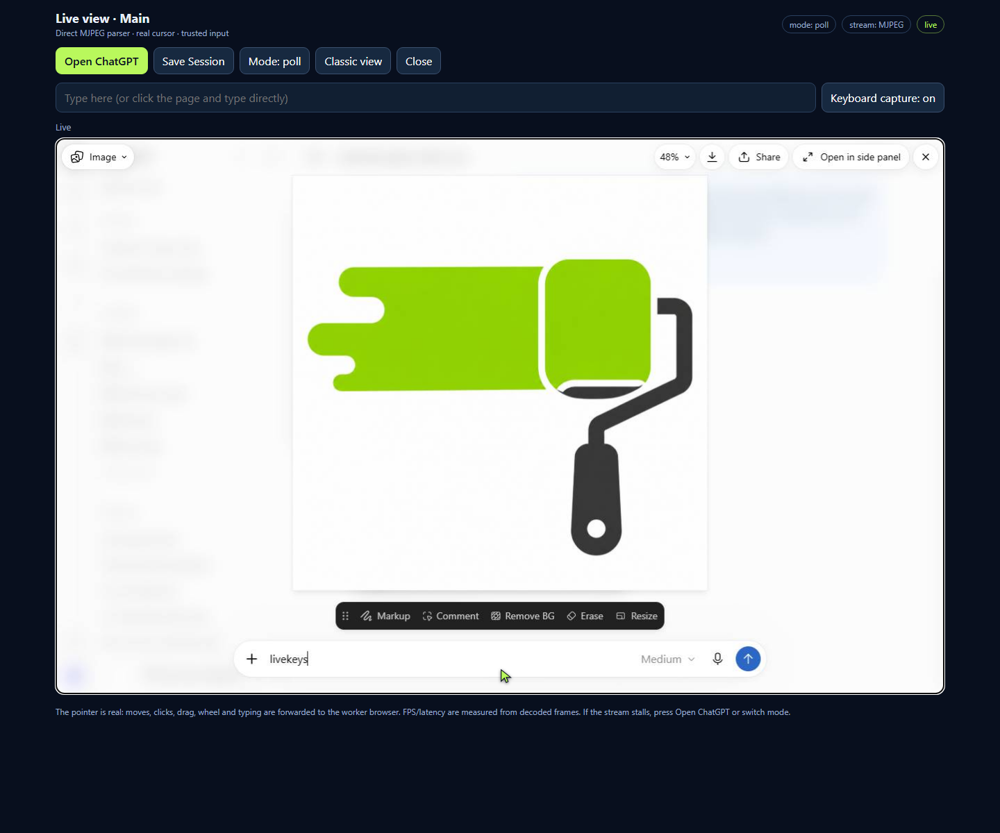

# راهنمای ورود به ChatGPT — سه روش، گام‌به‌گام

هر اکانت در Ninja Image Hub یک مرورگر مستقل دارد. برای تولید تصویر باید یک‌بار داخل همان مرورگر وارد ChatGPT شوی. **سه روش** وجود دارد؛ هر سه به یک نتیجه می‌رسند: سشن ذخیره‌شده در
`data/accounts/<ACCOUNT_ID>/gateway/auth/session.json`.

> این صفحه را فقط از `127.0.0.1` یا تونل SSH باز کن. هیچ‌وقت پنل را روی اینترنت عمومی بدون HTTPS و احراز هویت نگذار.

## کدام روش را انتخاب کنم؟



| روش | مناسب برای | نیاز به دیدن مرورگر | ذخیرهٔ رمز | سخت‌ترین بخش |
|---|---|---|---|---|
| ۱. صفحهٔ ریموت | سرور بدون مانیتور، هر جا | خیر (تصویر زنده در پنل) | خیر | کلیک روی کپچا/چالش‌ها سخت‌تر است |
| ۲. پنجرهٔ Chrome | ویندوز/مک/دسکتاپ لینوکس | بله | خیر | پنجره را نباید ببندی |
| ۳. لاگین خودکار | ۱۰ اکانت، اجرای طولانی، سرور | خیر | **بله** (فایل 0600) | باید رمز را یک‌بار وارد کنی |

---

## آماده‌سازی مشترک (قبل از هر روش)

1. پنل را باز کن: `http://127.0.0.1:8081` و با رمز ادمین وارد شو.
2. **Accounts → Add account** → نام بده → **Start**.
3. صبر کن تا `runtime` روی **online** برود (اولین بار ۵–۱۵ ثانیه: Xvfb + Chrome).
4. دکمهٔ **↗ Login** روی کارت اکانت را بزن. (این دکمه حالا برای اکانت متوقف هم کار می‌کند.)

معنای برچسب‌ها:

| برچسب | معنا |
|---|---|
| `online` | worker و مرورگر بالا هستند |
| `stopped` | مرورگر خاموش است (دستی یا با idle shutdown) |
| `connected` | آخرین بررسی gateway می‌گوید سشن ChatGPT معتبر است |
| `unverified` | هنوز بررسی نشده یا سشن نامشخص است؛ Job اول معمولاً آن را روشن می‌کند |
| `unknown` | gateway نتوانست سشن را تأیید کند (شبکه/Cloudflare) |

---

## روش ۱ — صفحهٔ لاگین ریموت (برای سرور بدون مانیتور)

پنل تصویر زندهٔ مرورگرِ سمت سرور را نشان می‌دهد و کلیک/تایپ تو را به آن می‌فرستد. هیچ رمزی در پنل ذخیره نمی‌شود.



1. در دیالوگ لاگین، **Open remote login page ↗** را بزن (در تب جدید باز می‌شود).
2. صفحه **خودش** سشن لاگین را باز می‌کند (تا ۸ بار تلاش با فاصله). اگر پیام خطا دیدی، یک‌بار **Open ChatGPT** را بزن. بدون سشن فعال، اسکرین‌شات با **409** رد می‌شود و پیام «login session is not active» می‌بینی.
3. چند ثانیه صبر کن تا تصویر مرورگر بیاید (اگر نیامد **Refresh**).
4. روی تصویر، فیلد ایمیل را کلیک کن → در کادر «Type into focused browser field» ایمیل را بنویس → **Type**.
5. با **Tab** به فیلد رمز برو → رمز را تایپ کن → **Type** (دکمهٔ **Show / Hide** برای دیدن متن است).
6. **Enter** را بزن یا دکمهٔ ورود را کلیک کن.
7. اگر 2FA/TOTP داری، کد را در همان فیلد تایپ و **Type** کن.
8. وقتی وارد شدی (نام کاربری/آواتار در تصویر دیده می‌شود)، **Save Session** را بزن. پیام موفقیت یعنی کوکی‌ها در `auth/session.json` ذخیره شدند.
9. صفحه را ببند و در پنل **Refresh status** را بزن؛ پیام موفقیت خودِ صفحه می‌گوید سشن تأیید شد یا نه (`session: connected` / `unverified`) و اگر gateway «login blocker» گزارش کرده باشد (مثل `mfa_required`) همان را نشان می‌دهد.

> **نکتهٔ مهم:** Save Session آن login session تعاملی را می‌بندد. برای کار دوباره با تصویر، دوباره **Open ChatGPT** را بزن.

---

### تعامل با تصویر — چرا «کرسر کار نمی‌کند» و چطور کار می‌کند

تصویرِ این صفحه **اسکرین‌شات زنده** است؛ داخل خودش کرسر یا hover واقعی وجود ندارد. هر کلیک تو به مرورگر worker فرستاده می‌شود و یک **حلقهٔ سبز** نشان می‌دهد کلیک کجا نشسته است. بنابراین:



### تایپ ساده‌تر شد (پیش‌فرض: Type directly: on)

از v0.6.4 لازم نیست جای خاصی تایپ کنی:

1. روی فیلد موردنظر در تصویر **کلیک کن** (حلقهٔ سبز روی هدف).
2. **همان‌جا هر جا که هستی تایپ کن** — حروف به مرورگر می‌روند؛ **Ctrl+V / paste** هم کار می‌کند (برای رمز از مدیر رمز عبور).
3. **Enter / Tab / Backspace / Esc** مستقیم ارسال می‌شوند.
4. اگر خواستی حالت قدیمی: **Type directly: off** → در کادر پایین تایپ کن و Enter بزن.

### ورود با Google / Apple / گوشی (SSO)

این دکمه‌ها یک **پنجرهٔ پاپ‌آپ** از دامنهٔ دیگری باز می‌کنند. v0.6.4 یک وصلهٔ محافظت‌شده روی gateway اعمال می‌کند تا صفحهٔ لاگین **جدیدترین پنجرهٔ باز** را دنبال کند؛ بنابراین تصویر پس از ~۲–۱۰ ثانیه باید صفحهٔ Google را نشان دهد.

اگر تصویر عوض نشد یا Google پیام «این مرورگر امن نیست» داد:

| گزینه | چه وقت |
|---|---|
| **پنجرهٔ Chrome worker روی دسکتاپ** (روش ۲) | ویندوز/مک/دسکتاپ لینوکس — Google کامل کار می‌کند |
| **VNC روی سرور** | سرور بدون مانیتور — یک مرورگر واقعی با کرسر/پاپ‌آپ |
| **ورود با ایمیل و رمز** | همیشه کار می‌کند و پایدارترین راه برای حالت خودکار است |

> Google معمولاً مرورگرهای خودکار را بلاک می‌کند؛ این محدودیت سرویس Google است، نه Hub. برای اجرای طولانی و ۱۰ اکانت، **روش ۳ (لاگین خودکار با ایمیل/رمز/TOTP)** بهترین انتخاب است.

### VNC روی سرور لینوکس (اگر SSO یا CAPTCHA لازم شد)

`GET /api/accounts` برای هر worker در حال اجرا فیلد `display` را برمی‌گرداند (مثلاً `":99"`). روی سرور:

```bash
sudo apt install -y x11vnc
x11vnc -display :99 -localhost -nopw -forever &
# از لپ‌تاپ: ssh -L 5900:127.0.0.1:5900 user@server
# سپس VNC به 127.0.0.1:5900
```

اینجا یک مرورگر واقعی می‌بینی (کرسر، پاپ‌آپ، Google) — کامل‌ترین راه برای هر چالش مرورگری.

### گیر کردن در صفحهٔ لاگین

- **Open ChatGPT** صفحه را دوباره بارگذاری می‌کند (فرم/مودال را می‌بندد).
- بعد از موفقیت **Save Session** بزن؛ صفحه پولینگ را متوقف می‌کند.
- اگر تب گیر کرد، همان تب مرورگر را ببند و از Accounts → ↗ Login دوباره باز کن. هیچ‌چیز در worker خراب نمی‌شود.


1. روی همان دکمه/فیلدی که در تصویر می‌بینی **کلیک کن**. اگر حلقهٔ سبز روی هدف نشست، کلیک درست بوده است.
2. اگر هدف کوچک است، دقیق‌تر کلیک کن یا از **Tab / Enter / Esc** استفاده کن (بعد از کلیک روی فیلد، Tab بین فیلدها می‌چرخد).
3. برای تایپ دو راه داری:
   - **مسیر معمول:** بعد از کلیک روی فیلد، پایین تایپ کن و **Enter** بزن (یا دکمهٔ Type). بعد از هر کلیک، کادر تایپ خودکار فوکوس می‌گیرد.
   - **تایپ مستقیم:** دکمهٔ **Type directly: on** را بزن؛ از این به بعد هر جا تایپ کنی به مرورگر می‌رود (حرف‌ها دسته‌ای، و Enter/Tab/Backspace فوری). کلیک روی تصویر فوکوس را روی تصویر نگه می‌دارد.
4. برای دیدن ادامهٔ صفحه **PgDn / PgUp** را بزن یا با چرخ ماوس روی تصویر اسکرول کن.
5. بعد از ورود: **Save Session** → وضعیت واقعی سشن (`connected`/`unverified`) و هر **login blocker** نمایش داده می‌شود.

> اگر کلیک «اثر نکرد»، یعنی هدف را نگرفته‌ای: حلقهٔ سبز باید روی همان دکمه بیفتد. این صفحه کلیک را تحریف نمی‌کند؛ مختصات با اندازهٔ واقعی تصویر (۱۲۸۰×۸۰۰ یا هر viewport) مقیاس می‌شود.

## روش ۲ — پنجرهٔ Chrome روی دسکتاپ (ساده‌ترین)

worker یک Chrome **واقعی** (headless نیست) باز می‌کند؛ روی ویندوز/مک/دسکتاپ لینوکس آن پنجره را می‌بینی.

1. روی کارت اکانت **↗ Login** را بزن و در دیالوگ، پایین روش ۲ را ببین.
2. اگر پنجرهٔ Chrome باز نیست: دکمهٔ **Open remote login page** را بزن و **Open ChatGPT** — این کار مرورگر را بیدار/بالا می‌آورد؛ یا اکانت را Stop/Start کن.
3. در همان پنجرهٔ Chrome (که پروفایل مخصوص همان اکانت را دارد) وارد ChatGPT شو. رمز و 2FA مستقیم در مرورگر تایپ می‌شوند.
4. بعد از ورود، در پنل **Refresh status** را بزن (یا تا ۵ دقیقه صبر کن؛ watchdog سشن را بررسی می‌کند).
5. Job اول را بفرست.

> **پنجرهٔ worker را نبند.** بستن آن = مرگ worker؛ supervisor تا ۸ بار برمی‌گرداند ولی سشن ذخیره‌نشده از دست می‌رود.
> اگر از idle shutdown استفاده می‌کنی، مرورگر بعد از بی‌کاری بسته می‌شود و با Job بعدی برمی‌گردد؛ برای همین **Save Session** را جدی بگیر.

---

## روش ۳ — لاگین خودکار (برای اجرای طولانی و ۱۰ اکانت)

اینجا رمز را یک‌بار به Hub می‌دهی تا gateway خودش وارد شود — هم در شروع، هم پس از انقضای سشن. برای سروری که کسی کنارش نیست، این راحت‌ترین گزینه است.



1. **Accounts → ↗ Login** روی اکانت موردنظر.
2. به بخش **3 · Automatic login** برو.
3. ایمیل ChatGPT را وارد کن.
4. رمز را وارد کن.
5. اگر 2FA فعال است، **TOTP secret** (رشتهٔ base32، همان چیزی که QR نشان می‌دهد) را وارد کن؛ فاصله‌ها مجازند.
6. **Save credentials** را بزن.
7. **Stop** و بعد **Start** روی همان اکانت (تنظیمات env فقط هنگام شروع worker خوانده می‌شوند).
8. در لاگ worker (`Logs`) باید خطی مثل
   `[session] ...` / `Auto-login ...` ببینی و بعد `session: connected`.



### امنیت این روش (بخوان)

- رمز در **دیتابیس ذخیره نمی‌شود**؛ در `data/accounts/<ACCOUNT_ID>/auto-login.json` با مجوز فایل **0600** نگهداری می‌شود و هیچ API‌ای آن را برنمی‌گرداند (فقط `configured` و `has_totp`).
- در audit فقط `has_totp` ثبت می‌شود، نه ایمیل/رمز.
- فقط از **اکانت اختصاصی** استفاده کن؛ نه اکانت اصلی. اگر دیسک رمزنگاری‌شده نیست، این فایل رمزنگاری نشده است.
- برای حذف: **Remove credentials**.

---

### حالت خودکار چطور کار می‌کند و چرا «فوق‌العاده» است

وقتی ایمیل/رمز/TOTP ذخیره شود، gateway آن‌ها را به‌عنوان `CHATGPT_EMAIL`، `CHATGPT_PASSWORD` و `CHATGPT_TOTP_SECRET` در محیط worker می‌گیرد و:

- در **شروع** worker خودش وارد می‌شود (warm-up)؛
- وقتی watchdog تشخیص دهد سشن مرده است، **دوباره** وارد می‌شود (بدون تو)؛
- اگر 2FA دارد، کد را از TOTP می‌سازد؛
- اگر رمز عوض شده باشد یا CAPTCHA/Turnstile جلوی ورود را بگیرد، در متریک gateway ثبت می‌شود و Hub آن را به‌صورت **login blocker** روی کارت اکانت نشان می‌دهد (`credentials_rejected`, `mfa_required`, `cloudflare_challenge`, `captcha`, …).

برای اعمال: در دیالوگ **Restart worker now (Stop → Start)** را بزن؛ این کار امن است (فقط همان اکانت، بدون ری‌استارت پنل).

> هشدار: رمز عوض‌شده = تلاش‌های ناموفق مکرر. اول **Remove credentials**، رمز جدید را ذخیره کن، بعد Restart. CAPTCHA/Turnstile را Hub دور نمی‌زند؛ اگر blocker نشان داد، باید یک‌بار دستی (روش ۱ یا ۲) وارد شوی.

## پروژهٔ ChatGPT: همهٔ تصویرها در «Ninja Image Hub» (نه بین چت‌های عادی)

هر Job یک گفتگوی جدید در ChatGPT باز می‌کند. با تنظیم **Project URL** برای هر اکانت، آن گفتگوها داخل **یک پروژه** ساخته می‌شوند و در لیست چت‌های عادی ظاهر نمی‌شوند.

### یک‌بار برای هر اکانت
1. در همان مرورگرِ همان اکانت، ChatGPT را باز کن → نوار کنار → **Projects** → **New project** → نام: **Ninja Image Hub**.
2. پروژه را باز کن و **آدرس نوار آدرس** را کپی کن (چیزی شبیه `https://chatgpt.com/g/g-p-XXXX-ninja-image-hub/project`).
3. در پنل: **Accounts → ✎ Edit** روی همان اکانت → فیلد **ChatGPT project URL** → آدرس را بچسبان → **Save changes**.
4. **Stop → Start** همان اکانت (تنظیم از طریق env به worker می‌رسد).
5. یک Job تستی بفرست؛ گفتگوی آن باید زیر همان پروژه در ChatGPT ظاهر شود، نه در «Recent chats».

> **نکتهٔ مهم:** لینک پروژه **برای هر اکانت جداست** (پروژه‌ها به حساب کاربری تعلق دارند). برای ۱۰ اکانت، در هر حساب یک پروژه به این نام بساز و URL همان حساب را در همان اکانت وارد کن.
> اگر فیلد را خالی بگذاری، رفتار قبلی برمی‌گردد: چت در لیست عادی ساخته می‌شود.

### چطور کار می‌کند
Hub در هر Start، یک وصلهٔ کوچک و محافظت‌شده روی gateway اعمال می‌کند: ثابت `CHATGPT_URL` در `src/chatgpt.js` به `process.env.CHATGPT_PROJECT_URL` وصل می‌شود؛ پس «چت جدید» به‌جای صفحهٔ اصلی، صفحهٔ همان پروژه را باز می‌کند. اگر نسخهٔ upstream عوض شود، وصله اعمال نمی‌شود و هیچ چیزی خراب نمی‌شود.

### ابزار تأیید مسیر پروژه

وقتی صفحهٔ لاگین ریموت باز باشد (init صدا زده شود)، دو مسیر تشخیصی هم در دسترس‌اند:

- `GET /api/accounts/<id>/remote/url` → آدرس/عنوان صفحه‌ای که مرورگر روی آن است (برای پیدا کردن URL پروژه).
- `GET /api/accounts/<id>/remote/pages` → همهٔ صفحه‌های باز مرورگر؛ چت‌های پروژه آدرسی مثل `/g/g-p-.../c/<id>` دارند، چت عادی `/c/<id>`.

> **واقعیت ChatGPT:** چت‌های داخل پروژه **در لیست Recents هم نمایش داده می‌شوند** (رفتار خود ChatGPT است). مسیر پروژه باعث می‌شود همهٔ تصویرها زیر **یک پروژه** جمع شوند، ولی «مخفی‌شدن از Recents» با این روش ممکن نیست.


## نمای زنده (Live view) — موس و کیبورد واقعی، سرعت بالا





دکمهٔ **Open live view (real-time mouse)** در دیالوگ لاگین، یک صفحهٔ زنده باز می‌کند که از **CDP screencast** داخل همان Chrome worker استفاده می‌کند، نه اسکرین‌شات ۴ ثانیه‌ای:

| قابلیت | جزئیات |
|---|---|
| موس | حرکت/کلیک/درگ/راست‌کلیک و چرخ ماوس به‌صورت **trusted input** (CDP Input domain) |
| کرسر | کرسر واقعی روی تصویر رسم می‌شود و بلافاصله حرکت می‌کند (بدون پایان فریم) |
| تایپ | تایپ مستقیم، paste، و کلیدهای Enter/Tab/Esc/Backspace/فلش‌ها |
| وضعیت | نشانگر **FPS** و **latency** بالای صفحه |
| دو حالت | `screencast` (پیش‌فرض؛ فریم فقط وقتی صفحه تغییر می‌کند، CPU کم) و `poll` (فریم ثابت با screenshot loop) |
| بازگشت | دکمهٔ **Classic view** همان صفحهٔ قبلی (اسکرین‌شات + Type) را باز می‌کند |
| ذخیره | **Save Session** از داخل همان صفحه |

### چطور استفاده کنیم
1. Accounts → **Login** → **Open live view (real-time mouse)**.
2. اگر لازم بود **Open ChatGPT** را بزن (سشن لاگین باز می‌شود).
3. کلیک/تایپ مستقیم؛ اگر صفحه کند شد، `?mode=poll` را به انتهای آدرس اضافه کن.
4. بعد از ورود **Save Session** و بستن تب.

**تنظیم سرعت و تایپ (v0.8):**
- **حالت پیش‌فرض screencast** با یک repaint سبک ۲px؛ اندازه‌گیری پس از پاک‌سازی پروسه‌های سرگردان: **~۱۹ fps** (poll ~۶ fps، قبلاً ~۱–۲ fps).
- سه پروفایل کیفیت: **fast** (720×450, q30, scale .55)، **balanced** (860×560, q38)، **sharp** (1280×800, q52)؛ دکمهٔ **Quality** بالای صفحه.
- نشانگر **sync** تأخیر واقعی بین ارسال ورودی تا رسیدن فریم بعدی را نشان می‌دهد.
- **ریپل کلیک**: با هر کلیک یک حلقهٔ سبز روی تصویر پخش می‌شود (بازخورد فوری، مستقل از شبکه).
- **شکل کرسر** از خود صفحهٔ worker خوانده می‌شود: روی فیلد متنی `text`، روی دکمه/لینک `pointer`، بقیه `default`.
- **باگ فوکوس و کیبورد رفع شد:** قبلاً بعد از هر کلیک، فوکوس به کادر متنِ خود پنل منتقل می‌شد و تایپ همان‌جا می‌ماند؛ حالا فوکوس روی صفحهٔ worker می‌ماند. `insertText` + یک key event واقعی برای کامپوزرهایی مثل ProseMirror ارسال می‌شود.
- تست end-to-end: کلیک روی کامپوزر از داخل نمای زنده و تایپ `livekeys` در ChatGPT ثبت شد (تصویر بالا).

> **صادقانه:** حالت `screencast` فقط هنگام repaint فریم می‌فرستد؛ در idle کم است ولی کلیک/تایپ سریع می‌رسد. حالت `poll` نرخ ثابت‌تری دارد و CPU بیشتری می‌برد. روی سرور Linux+Xvfb باید دوباره اندازه‌گیری شود؛ این عددها از ایستگاه تست ویندوز است.

### چرا این طراحی (و نه VNC)
پروژه‌های متن‌باز مشابه: **noVNC** (کلاینت VNC وب)، **KasmVNC** (سرور VNC مدرن)، **Selkies** (استریم WebRTC دسکتاپ)، **Steel Browser** و **browserless** (API مرورگر با CDP)، و خود **Playwright/Puppeteer** که screencast را از CDP می‌گیرند. VNC نیاز به x11vnc + websockify + شبیه‌سازی نمایشگر دارد و برای هر اکانت یک پورت اضافه می‌کند؛ ما همان CDP را داخل gateway که از قبل Chrome را کنترل می‌کند استفاده کردیم: بدون پورت تازه، بدون سرور VNC، و با همان احراز هویت پنل.


## روش‌های پیشرفته (اختیاری)

### الف) VNC روی سرور لینوکس

اگر می‌خواهی مرورگر واقعی را با کیفیت کامل ببینی (مثلاً برای چالش Cloudflare):

```bash
sudo apt install -y x11vnc
# اگر Hub خودش Xvfb می‌سازد، یک DISPLAY ثابت بساز و به Hub بده:
Xvfb :99 -screen 0 1440x900x24 &
export DISPLAY=:99
x11vnc -display :99 -localhost -nopw -forever &
# Hub را با همان DISPLAY اجرا کن:
DISPLAY=:99 python -m uvicorn app:app --host 127.0.0.1 --port 8081 --workers 1
# از لپ‌تاپ: ssh -L 5900:127.0.0.1:5900 user@server → VNC به 127.0.0.1:5900
```

### ب) انتقال سشن از یک ماشین به ماشین دیگر

اگر روی لپ‌تاپ لاگین کرده‌ای و می‌خواهی همان سشن را به سرور ببری، فایل را عیناً کپی کن:

```bash
# روی ماشین مبدأ
data/accounts/<ID>/gateway/auth/session.json
# روی سرور، همان مسیر با همان ID اکانت
```

سپس worker را Stop/Start کن. ⚠️ این فایل **کوکی‌های سشن** است؛ مثل رمز با آن رفتار کن و در ریپو/چت نگذار.

### ج) CDP (فقط توسعه)

`BROWSER_MODE=cdp` + یک Chrome با `--remote-debugging-port`؛ برای کنترل کامل بیرونی. در تنظیمات پیش‌فرض لازم نیست.

---

## بدترین سناریوها — و رفتار دقیق سیستم

| سناریو | قبلاً چه می‌شد | حالا چه می‌شود |
|---|---|---|
| worker خوابیده (idle shutdown) و صفحهٔ لاگین باز می‌شود | پیام مبهم «Worker unavailable» | صفحه worker را بیدار می‌کند، تا **۱۵ ثانیه** صبر می‌کند و اگر بالا نیامد علت + راهنما می‌گوید |
| **یک Job در حال اجراست** و صفحهٔ لاگین باز می‌شود | صفحه بی‌نهایت «Initializing…» می‌ماند | `init` حداکثر ۲۰ ثانیه صبر می‌کند، سپس پیام «browser busy with a running generation job» و **تلاش خودکار مجدد** |
| سشن تعاملی gateway بعد از **۱۰ دقیقه** بی‌کاری بسته می‌شود | اسکرین‌شات فقط ۴۰۹ می‌داد | خود صفحه حداکثر **۹ دقیقه** پول می‌کند (قبل از انقضا) و بعد می‌گوید «برای آزادکردن مرورگر متوقف شد؛ Open ChatGPT را بزن» |
| بعد از **Save Session** | پیام موفقیت در ۴ ثانیه با «unavailable» بازنویسی می‌شد | پول متوقف می‌شود؛ نتیجهٔ واقعی سشن (`connected`/`unverified`/`unknown`) از متریک gateway نمایش داده می‌شود |
| سشن پنل (کوکی ادمین) منقضی شد | خطای مبهم fetch | پیام «Panel session expired — reload and sign in» |
| کلید CSRF عوض شد (ورود مجدد در تب دیگر) | ۴۰۳ خاموش | همان پیام + توقف عمل |
| سشن لاگین بین Save و تلاش دوباره بسته شده | ۴۰۹ خشک | صفحه سشن را دوباره باز می‌کند و Save را **یک‌بار** تکرار می‌کند |
| دو تب لاگین هم‌زمان | کلیک‌ها قاطی می‌شدند | اکشن‌ها سریال می‌شوند (busy lock)، اسکرین‌شات مشترک است، Save در gateway صف می‌شود |
| دسکتاپ بدون پنجره (Xvfb) | کاربر دنبال پنجرهٔ ناموجود می‌گشت | در دیالوگ لاگین و در خود صفحه نوشته می‌شود که پنجره‌ای روی میز نیست و باید از روش ۱/۳ استفاده شود |
| auto-login با رمز/2FA اشتباه | فقط `unverified` بی‌توضیح | `session_blocker` از متریک gateway خوانده و در کارت اکانت/دیالوگ نشان داده می‌شود (`mfa_required`, `cloudflare_challenge`, `credentials_rejected`, …) |
| فایل auto-login خراب/دستی‌ویرایش‌شده | بی‌صدا نادیده گرفته می‌شد | وضعیت `configured: false` با هشدار «credentials are unreadable; save them again» |
| auto-login ذخیره شد ولی worker ری‌استارت نشد | انتظار بی‌نتیجه | در UI صریح: «Stop → Start تا اعمال شود» |
| بستن پنجرهٔ Chrome در روش ۲ | سشن ذخیره‌نشده از دست می‌رفت | supervisor برمی‌گرداند؛ اما درس: قبل از بستن، Save Session بزن |
| مختصات کلیک با اندازهٔ واقعی اسکرین‌شات نمی‌خواند | کلیک به جای غلط می‌رفت | مختصات با `naturalWidth/naturalHeight` تصویر مقیاس می‌شود و سقف مجاز به ۴۰۹۶ بزرگ شد |

> **نکتهٔ امنیتی:** روش ۳ رمز را روی دیسک نگه می‌دارد. اگر رمز ChatGPT را عوض کردی، اول **Remove credentials** بعد رمز جدید را ذخیره کن؛ با رمز قدیمی gateway تلاش‌های ناموفق تکرار می‌کند و ممکن است حساب موقتاً قفل شود.


## عیب‌یابی

| نشانه | علت | کار |
|---|---|---|
| «login session is not active» یا اسکرین‌شات خالی (409) | login session فعال نیست | **Open ChatGPT** را بزن، بعد **Refresh** |
| تصویر مرورگر نمی‌آید | worker در حال بالا آمدن یا مرده | چند ثانیه صبر؛ Accounts → وضعیت؛ Stop/Start |
| `session: unverified` می‌ماند | watchdog هنوز بررسی نکرده یا Cloudflare | تا ۵ دقیقه یا یک Job بفرست؛ بعد Stop/Start |
| Save Session خطا می‌دهد | session فعال نیست | اول Open ChatGPT، بعد Save |
| After login still logged out | مرورگر/پروفایل عوض شده (worker ری‌استارت بین لاگین) | دوباره لاگین؛ برای پایداری روش ۳ |
| Auto-login کار نمی‌کند | worker ری‌استارت نشده، یا TOTP/رمز غلط | Stop/Start؛ Logs را ببین؛ TOTP base32 بدون فاصله هم قبول است |
| 2FA/Turnstile/کپچا | چالش امنیتی ارائه‌دهنده | روش ۲ یا VNC؛ Hub آن را دور نمی‌زند |
| `429` بعد از لاگین | محدودیت نرخ | cooldown ۳۰ دقیقه؛ اکانت عوض نکن |
| اکانت Stop شده، Job در صف می‌ماند | طراحی عمدی | Start بزن (یا job برای اکانت دیگر بفرست) |

---

## چک‌لیست قبل از اولین تصویر

- [ ] اکانت ساخته و `Start` شده و `runtime: online` است.
- [ ] لاگین انجام شده (یکی از سه روش) و **Save Session** زده شده (روش ۱/۲) یا auto-login ذخیره و worker ری‌استارت شده (روش ۳).
- [ ] در Accounts وضعیت سشن `connected` است (یا حداقل یک‌بار Job موفق داشته‌ای).
- [ ] در Image Studio اکانت درست انتخاب شده، `n` از `max_batch_images` بیشتر نیست.
- [ ] برای چند اکانت: `max_running_accounts` و `global_max_inflight` را مطابق ظرفیت سرور تنظیم کرده‌ای (به `docs/OPERATIONS_FA.md` نگاه کن).
